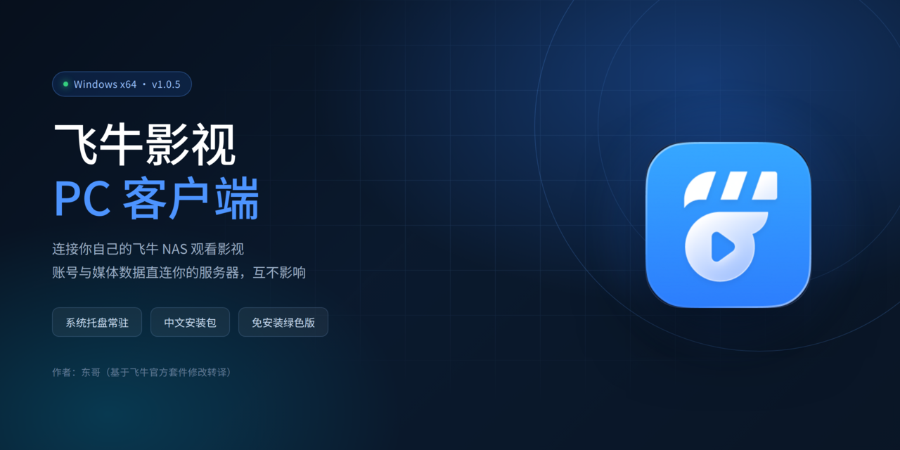
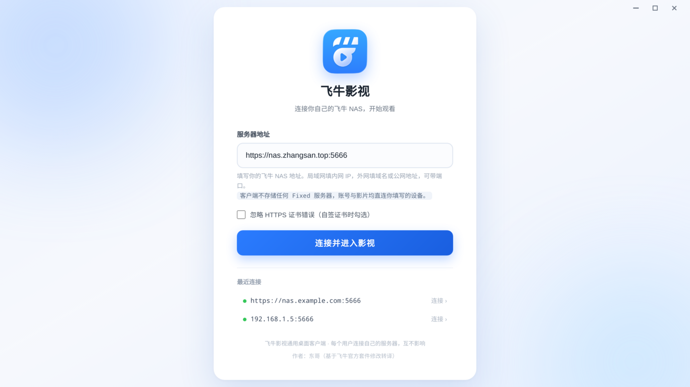
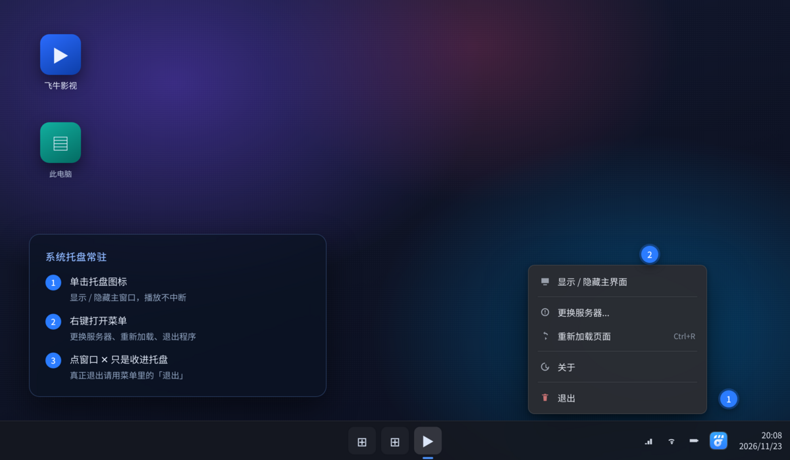

<div align="center">
  
</div>

<h1 align="center">飞牛影视 PC 客户端（Windows）</h1>

<p align="center">
把飞牛影视的网页版装进一个独立的桌面窗口 —— 补上窗口控制、系统托盘、多服务器管理这些桌面端该有的便利。<br>
<b>不改动服务器，不内置任何地址，每个人连接自己的 NAS。</b>
</p>

<p align="center">
  
  
  
  
</p>

> **作者：东哥** · 本项目为个人学习作品，与飞牛官方无任何关联，详见 [免责声明](DISCLAIMER.md)

---

## 下载

| 版本 | 适用场景 | 大小 | 下载 |
| :--- | :--- | :--- | :--- |
| **安装版** v1.0.6 | 常规使用，自动创建桌面与开始菜单快捷方式，可从"应用和功能"正常卸载 | 73.9 MB | [FeiNiuYingShi-PC-1.0.6-setup.exe](https://github.com/zuodila/FNtv-pc-windows/releases/download/v1.0.6/FeiNiuYingShi-PC-1.0.6-setup.exe) |
| **绿色版** v1.0.6 | 免安装、不写注册表，解压后双击 `fntv.exe` 即用，适合放 U 盘 | 105.1 MB | [FeiNiuYingShi-PC-1.0.6-portable.zip](https://github.com/zuodila/FNtv-pc-windows/releases/download/v1.0.6/FeiNiuYingShi-PC-1.0.6-portable.zip) |

**系统要求**：Windows 10 / 11 x64

**校验值**（下载后可用 `certutil -hashfile 文件名 SHA256` 核对）：

```
setup.exe      a7314abe1a70332c6347291ff12813dc664705d0d85bcdef28476ff51ada84d4
portable.zip   97122de7738c488c54dbf8e20ddbf46c4d694852d63433bb4fbfbf585140f79e
```

> 请只从本仓库 Releases 下载。第三方渠道转载的版本未经确认，安全性与完整性无法保证。

---

## 功能特性

- **多服务器 · 互不影响** —— 每个使用者填自己的 NAS 地址，客户端不内置任何固定服务器，打开时必须由你主动填写
- **系统托盘常驻** —— 点 ✕ 收进托盘后台运行，播放不中断；单击图标显示 / 隐藏，右键菜单可更换服务器、重载、退出
- **无边框窗口** —— 右上角 `─ □ ✕` 三键，顶部标题区与左右边缘均可拖动窗口
- **自签证书兼容** —— 外网 NAS 常用自签 HTTPS，勾选即可跳过证书校验
- **连接向导 + 最近连接** —— 首次启动引导填写地址，之后可从历史记录一键切换
- **外链走系统浏览器** —— 客户端内不会跳转到不明页面
- **零数据收集** —— 无统计、无埋点、无广告；地址与偏好只存在本机

## 界面截图

### 1. 连接向导（首次启动）



填写 NAS 地址即可进入。局域网填内网 IP，外网填域名或公网地址，可带端口。

### 2. 登录页（进入影视后）


用你自己的飞牛账号登录，账号与影片数据直连你的服务器。

### 3. 系统托盘



关闭窗口只是收进托盘。要真正退出程序，请用托盘右键菜单里的「退出」。

---

## 使用方法

1. 下载**安装版**（推荐）或**绿色版**
2. 启动后在连接向导里填写你的 NAS 地址，例如
   - 局域网：`192.168.1.5:5666`
   - 外网：`https://media.example.com:8443`
3. 点「连接并进入影视」，用飞牛账号登录
4. 想换服务器：托盘右键「更换服务器...」，或按 `Ctrl + Shift + S`
5. 重载页面：`Ctrl + R`；退出程序：托盘右键「退出」

## 常见问题

<details>
<summary><b>提示证书错误 / 页面打不开</b></summary>

如果用自签证书的 HTTPS 地址，请勾选连接向导里的「忽略 HTTPS 证书错误」。

如果是 `http://` 地址却打不开，先在浏览器里访问 `http://你的地址:端口/v` 确认服务正常。
</details>

<details>
<summary><b>连接一直转圈 / 白屏</b></summary>

1. 确认 NAS 的飞牛影视服务已启动
2. 确认客户端所在网络能访问该地址（手机连同一 WiFi 用浏览器试）
3. 外网访问需要路由器端口映射或内网穿透，端口不通时客户端也连不上
</details>

<details>
<summary><b>点了 ✕ 程序不见了，怎么退出/找回</b></summary>

点 ✕ 是收进系统托盘（右下角通知区域，可能要点开 `^` 展开）。单击托盘图标即可恢复窗口，右键托盘图标选「退出」才是真正关闭程序。
</details>

<details>
<summary><b>能在 macOS / Linux 上用吗</b></summary>

当前只构建了 Windows x64 版本。项目基于 Electron，理论上可自行在其它平台打包，但作者未做适配与测试。
</details>

<details>
<summary><b>会被官方封号吗</b></summary>

客户端只是加载你自己服务器的网页，不做任何协议篡改、不伪造请求、不绕过鉴权，与在浏览器中访问等价。但请遵守你服务器的使用条款，风险自担。
</details>

## 技术说明

- Electron 28 + 原生 HTML/CSS（连接向导、错误页）
- 主进程负责窗口、托盘、配置持久化、证书策略；页面通过 `contextBridge` 暴露的极小 API 与主进程通信
- 安装包使用 Unicode 版 NSIS 3.11 编译，完整支持中文路径
- 不修改、不注入飞牛服务端；仅在远程页面上叠加桌面端所需的窗口控制条

## 源码

源代码全部公开，可自行审计、编译。

```
main.js              主进程：窗口、托盘、配置持久化、证书策略、快捷键
preload.js           预加载：contextBridge 暴露极小 API，叠加窗口控制条
ctrl_css.js          窗口控制条样式
renderer/setup.html  连接向导页
renderer/error.html  错误页
renderer/logo.png    应用图标
package.json         依赖与 electron-builder 配置
build/icon.png       打包用图标源文件
```

**编译**（需 Node.js 18+）：

```bash
npm install
npm run dist          # 产出 dist/ 下的安装版与绿色版
```

只想本机运行调试：

```bash
npm start
```

配置写在 `%APPDATA%/fntv-desktop/config.json`，只存你填的服务器地址与窗口尺寸，不含任何账号信息，也不会回传。

## 许可

源码可见，但**禁止商业使用**：不得销售、付费分发、冒充官方发布。个人学习、研究、非商业修改与再分发需保留署名与许可。详见 [LICENSE](LICENSE)。

## 免责声明

**本项目为个人学习与技术研究作品，非飞牛（fnOS）官方产品，与官方无任何隶属或授权关系。**

- 不包含、不破解、不分发任何官方服务端程序，不提供任何影视资源或账号
- 软件按「现状」提供，不作任何担保，使用风险自负
- 禁止商业销售、付费分发或冒充官方发布
- 界面中的商标、影片海报版权归各权利人所有；如有侵权请开 Issue，核实后立即删除

完整条款请阅读 **[DISCLAIMER.md](DISCLAIMER.md)**。
